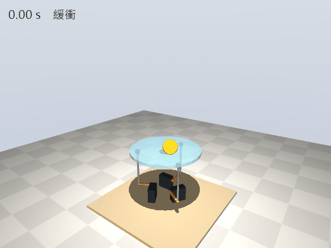
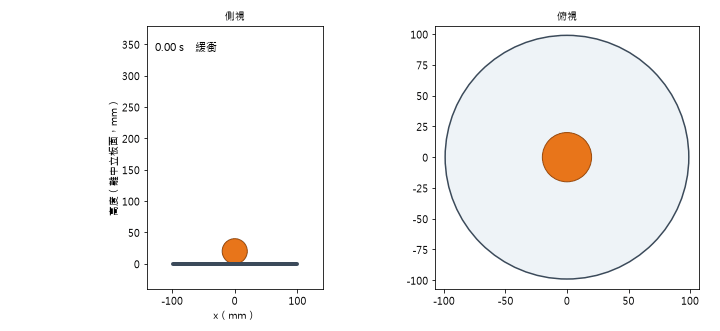
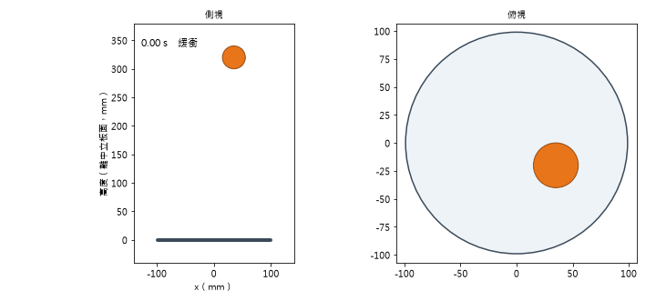
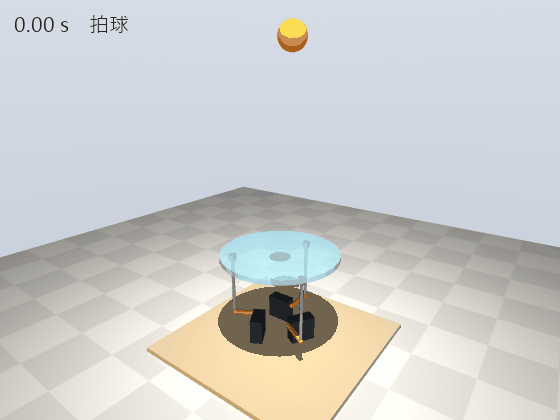
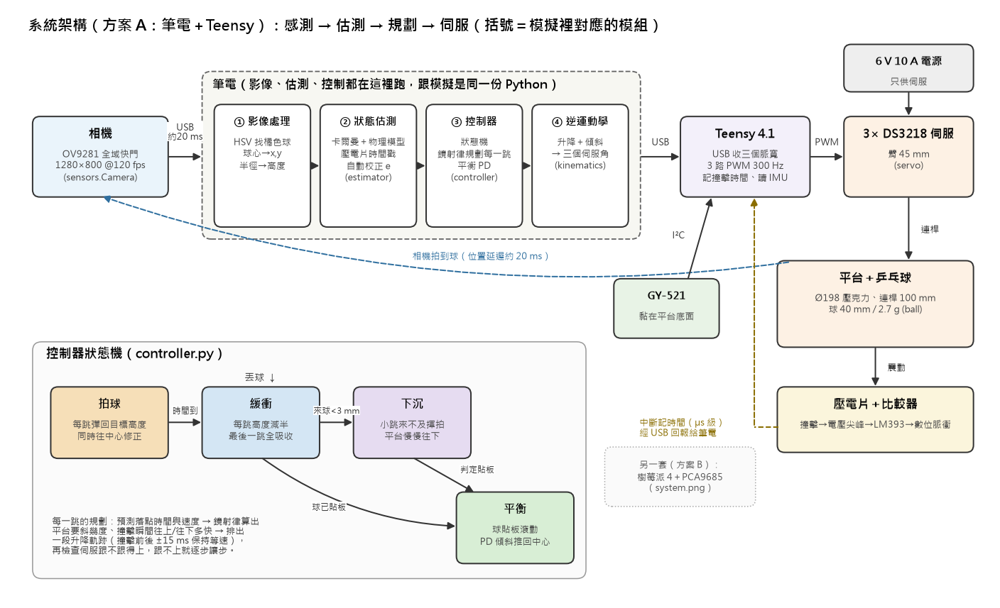
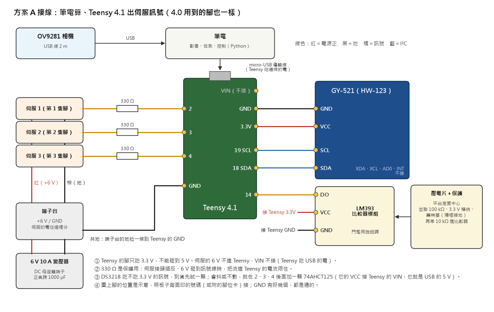
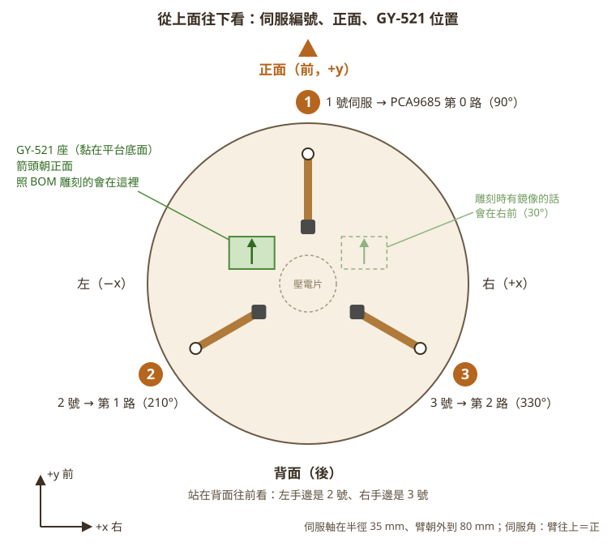

# 乒乓球平台：方案 A（筆電＋Teensy 4.1）實機程式需求與測試流程

> 2026-10-27 整理，給寫這套程式的同學和她的 AI。
> 範圍：Teensy 4.1 韌體、筆電端的控制程式和每一個測試工具、每個測試的流程和通過標準、要達到的成績、全部參數、模擬結果。
> 機構和列印件（CAD）不在這包裡。這包有哪些檔案見第 14 節。
> 標「（建議）」的是整理這份文件時提的做法，還沒跟使用者定案，可以改；其他的是使用者和之前的對話已經定的，或實測、查證過的。

## 0. 給 AI 的工作規則（先讀）

1. **要做什麼**：寫第 4 節表格裡的程式。照第 9 節的順序一支一支做，每一支都要有第 10 節的自動測試。
2. **專案程式在 `code/`**（2026-10-27 的快照，沒有 CAD）：
   - `code/ppsim/`：模擬。控制器、估測器、運動學都在這裡，**實機直接用同一份**，不要另外寫一套控制器。
   - `code/ppreal/`：實機工具。相機那部分已經寫好（另一個對話寫的，原本給樹莓派那套用，Windows 上也能跑）。
   - `code/tests/`：現在 116 個測試，在 `code/` 裡跑 `python -m pytest -q tests`，約 2 分鐘，**要一直全過**。
3. **不能改**：`ppsim/params.py` 的預設值，還有 `ppsim/` 的控制器和估測器（模擬結果全靠它們）。實機要用不同的值（PWM 300 Hz、提前量、實際的相機），在實機程式裡另外設。
4. **照現有的格式**：
   - 紀錄和校正檔照 `參考文件/2026-10-27-測試紀錄與監控-design.md`，第 3、4、9 節：每次測試一個資料夾，裡面有 `meta.json`、`control.bin` 等檔案，校正檔是 `calib.json`。
   - 工具的名字和流程照 `參考文件/硬體上機檢查清單.md`。
   - 這兩份是照樹莓派那套寫的。Teensy 版跟它們不一樣的地方，寫在本文件第 7、8、9 節。
5. **先問使用者再做**：新建頂層資料夾、燒錄 Teensy（會蓋掉它原本的程式）、安裝新套件。
6. **筆電內建的鏡頭會拍到人**：程式只開名字含 `PC CAMERA` 的相機。`ppreal/camera.py` 已經這樣做了，不要改成用編號去開別顆。
7. 給使用者看的字（終端機輸出、報告）用繁體中文。程式碼的註解短就好。
8. **第一個里程碑是期中**（平衡＋手推）。壓電片、拍球、Teensy 照時間播是期末的事，現在先把介面和封包類型留好。

---

## 1. 這台機器、要達到什麼

### 1.1 機器

- 3-RRS 平台：三顆 DS3218 伺服（180° 版）各帶一支 45 mm 的臂，經 100 mm 的連桿撐起平台。平台是 Ø198 mm、8 mm 厚的黑色霧面壓克力，球是 40 mm 的乒乓球。
- 平台只有三個自由度：升降和兩軸傾斜。另外三個（前後滑、左右滑、扭轉）由機構連帶決定，`ppsim/kinematics.py` 會算。
- 感測：
  - 上方相機找球：期中用替代相機，之後換 OV9281。
  - 平台底面黏一顆 IMU：HW-123，晶片是 MPU-6050。
  - 平台底面中心貼壓電片，經 LM393 比較器抓撞擊，期末拍球才用。
- 控制：筆電算（相機、找球、估測、控制、逆運動學）；Teensy 4.1 出三路伺服 PWM、記撞擊時間、讀 IMU。兩個用 USB 連。
- 比賽規則（跟程式有關的）：平台上不能有凸起、表面不能黏、周圍不能有圍欄；收合後要在 20×20×20 cm 以內。收合＝三顆伺服轉到 −60°，平台降到最低。

### 1.2 期中要達到（現在的目標）

1. 乒乓球在平台上穩定平衡至少 20 秒。
2. 用手輕推，可以平衡回來。

實機的驗收在第 9 節的 A10，跟清單第 9 階段一樣：

| 項目 | 怎樣算過 |
|---|---|
| 放偏 | 球靜止放在離中心 3–4 cm，4 秒內回到中心 1 cm 內（替代相機延遲大的話可能要 5 秒） |
| 平衡 20 秒 | 連做 5 次都沒掉，穩住後在中心 1 cm 內 |
| 手推 | 球在中心時往 8 個方向各輕推一次：不掉，而且回到中心 1 cm 內。OV9281：3 秒內；替代相機：5 秒內 |
| 久一點 | 連續平衡 2 分鐘，伺服不燙 |

### 1.3 期末（之後）

- 拍球：讓球固定彈跳，並導回中心。預設目標 15 cm，模擬裡最高穩定約 25 cm。
- 接球緩衝：從上方丟下，每跳高度減半，最後停住、轉平衡。
- 側拋接球：從正面或背面拋弧線過來。
- 這些都要壓電片的撞擊時間。Teensy 最好改成「一次收接下來 30–50 ms 的角度＋時間，照時間播」（第 5.7 節）。

### 1.4 模擬裡的樣子（現在的參數，2026-10-27 重跑）



MuJoCo（閉鏈多體動力學＋直流馬達伺服模型）。球靜止放在離中心 3.6 cm 的地方，拉回中心。第 5 秒往正面推成 0.25 m/s，球滾到離中心約 67 mm，再被拉回來；推完 3 秒後離中心最遠 5.9 mm。



純 Python 模擬，相機換成期中用的替代相機（640×480、每秒 30 張、延遲 60 ms）。第 2 秒往正面推成 0.20 m/s，球最遠滾到約 69 mm，3.55 秒後回到 1 cm 內、沒掉。



純 Python：從上方丟下，每跳減半，約 2.0 秒接到平衡。



MuJoCo：拍球 4 秒（目標 15 cm），再緩衝、平衡。

---

## 2. 系統架構



### 2.1 分工

- **Teensy 只做四件事**：出三路 PWM、壓電片撞擊時用中斷記 `micros()`、讀 IMU、把這些回報給筆電。
- **筆電**跑相機、找球、估測、控制、逆運動學。用的就是模擬那一份 Python（`ppsim`），不用移植。

### 2.2 筆電上分成三個程式

跟樹莓派那套一樣（紀錄規格第 10 節），只是控制程式改成用 USB 跟 Teensy 講話，IMU 也從 Teensy 的回報來。

| 程式 | 做什麼 | 寫哪些檔 |
|---|---|---|
| 啟動程式 | 開測試資料夾、寫 meta、開另外兩個程式、讀鍵盤、印狀態行和摘要；從共享記憶體收控制程式的紀錄寫檔 | `meta.json`、`events_*.csv`、`control.bin`、`imu.bin`、`piezo.csv`、`system.csv`、`console.log`、`usb.csv` |
| 找球程式 | 讀相機、找球，最新的量測放進共享記憶體；另一條執行緒錄影 | `camera.csv`、`cam.mjpeg`、`events_vision.csv` |
| 控制程式 | 500 Hz 迴圈：讀最新量測和 Teensy 回報，跑 `ppsim` 的估測器和控制器，算逆運動學和脈寬，用 USB 送 Teensy；每拍一列寫進共享記憶體 | 不寫檔 |

為什麼要這樣分（2026-10-26 在這台筆電實測：Windows 11、Ryzen 6000、Python 3.12、插電；每拍先空轉 0.6 ms 假裝在算控制，每種 7,500 拍）：

1. 控制迴圈和找球放在同一個程式的兩條執行緒：一半以上的拍晚超過 2 ms，最壞 28–66 ms。原因是兩條執行緒搶同一把 GIL，Python 每 5 ms 才換手。放成兩個程式：7,500 拍裡只有 0–27 拍晚，最壞 0.9–9 ms。
2. 等下一拍的方法：
   - `time.sleep`：一般優先權最壞 2.2–49 ms；高優先權的 15 秒裡還有 13 拍晚超過 2 ms。`timeBeginPeriod(1)` 沒有幫助。
   - 空轉等：一般優先權最壞 1.4–2.7 ms；**高優先權最壞 0.16 ms、沒有一拍晚**，代價是佔滿一個 CPU 核心。
   - 睡到前 1 ms 再空轉：約 0.7 核，但最壞 1.9 ms（高優先權）到 3.3 ms（一般），餘量很小。
3. 所以控制程式要用高優先權＋空轉等下一拍。
4. 控制程式也不寫檔、不印東西：寫檔偶爾會卡幾十 ms。
5. 限制：每種只跑 15 秒，幾分鐘才一次的卡頓量不到；用電池時要重量。

---

## 3. 硬體與接線



### 3.1 腳位（Teensy 4.0、4.1 一樣；照板子背面印的號碼接）

| Teensy 的腳 | 接到 | 說明 |
|---|---|---|
| 2、3、4 | 伺服 1、2、3（第 1、2、3 隻腳）的訊號線，各串一顆 330 Ω | 都設 300 Hz、15 bit。2 和 3 共用一個計時器，設一支另一支也跟著變 |
| GND | 端子台的地 | 共地，只拉這一條 |
| 3.3V | IMU 的 VCC、比較器的 VCC | 3.3V 腳最多給 250 mA，這兩個加起來不到 10 mA |
| GND（另一個） | IMU 的 GND、比較器的 GND | GND 有好幾個，都是通的 |
| 19（SCL）、18（SDA） | IMU 的 SCL、SDA | I²C 位址 0x68 |
| 14 | 比較器的 DO | 用中斷記 `micros()` |
| VIN | 不接 | Teensy 吃 USB 的電 |
| 13（板上的 LED）或另外一支空腳 | 對時 LED（選配，建議） | Teensy 放在相機拍得到的地方，就直接用板上第 13 腳的 LED；拍不到的話，另外接一顆紅色 5 mm LED 串 330 Ω 到一支空腳（例如第 5 腳）。用途見 A9-8 |

### 3.2 電的規矩

1. Teensy 的腳只吃 3.3 V（PJRC 原文：the pins are not 5V tolerant）。任何一支腳都不能碰到 5 V 或伺服的 6 V。
2. Teensy 吃筆電 USB 的電，VIN 不接。
3. 伺服的 6 V（6 V 10 A 變壓器）從端子台直接給三顆伺服；端子台的地拉一條到 Teensy 的 GND（共地）。
4. 三條伺服訊號線各串 330 Ω：伺服接頭插反、6 V 碰到訊號線時，把流進 Teensy 的電流限住。
5. DS3218 吃不吃 3.3 V 的訊號，規格表沒寫、也沒找到別人的紀錄，到貨要測（A3-4）。不行就加 74AHCT125：
   - VCC 接 Teensy 的 VIN（也就是 USB 的 5 V），最高只能 5.5 V，不能接伺服的 6 V。
   - 四個 OE 腳接 GND，沒用到的那一路輸入也接 GND。
   - 三路輸入各接一顆 10 kΩ 到 GND，讓 Teensy 開機那一下輸入不會浮著。
6. **伺服電源的插頭（或開關）要放在手邊，這就是緊急停止。** 每次開伺服電之前，手先放在它旁邊。

### 3.3 編號和方向



1. 正面（前）＝1 號伺服那一側＝ +y＝方位角 90°；右邊＝ +x。
2. 從上面看逆時針是 1（90°）、2（210°，左後）、3（330°，右後）。伺服 1、2、3 接 Teensy 第 2、3、4 腳。
3. `ppsim` 裡三顆伺服的順序也是 1、2、3（`legs_deg = (90, 210, 330)`）。
4. 伺服角：臂水平＝0、往上為正，單位弧度（`ppsim` 的定義）。脈寬加大時臂往上還是往下要量（A4-2），存成 `dir`。
5. 傾斜 τ＝(tx, ty)：指向下坡、用 tan 值，球會往 τ 的方向滾（`kinematics.tilt_normal`）。

### 3.4 相機

- **期中：替代相機「USB2.0 PC CAMERA」**
  - 640×480、每秒 30 張、YUYV。
  - 一定要手動曝光：自動曝光時相機嫌暗、把曝光拉長，會掉到每秒 10–12 張；`--exposure -7` 是每秒 29.75 張、沒掉張（2026-10-27 實測，室內白天）。
  - 視角用 `cam fov` 量。模擬假設水平 55°、鏡頭在板面上方 45 cm。
  - 畫面上方要朝正面（1 號那側）。
- **之後：OV9281 USB**
  - 1280×720、每秒 120 張、MJPG、全域快門，水平視角約 95–99°。
  - 在 Windows 上怎麼設，見第 6.4 節。

---

## 4. 要寫的程式（總表）

| # | 程式 | 在哪跑 | 做什麼 | 期中要不要 |
|---|---|---|---|---|
| 1 | Teensy 韌體 | Teensy | 收命令出 PWM、斷線回中位、讀 IMU、記撞擊、回報、回 ping | 要 |
| 2 | USB 連線模組 | 筆電（給 3–10 用） | 封包編解碼、專門讀的執行緒、對時 | 要 |
| 3 | `usb` 測試 | 筆電 | 量 USB 延遲、對時誤差（A1） | 要 |
| 4 | `loop` 測試 | 筆電 | 500 Hz 迴圈準不準（A8） | 要 |
| 5 | `servo …`、`motion …` | 筆電 | 送固定脈寬、認伺服、找方向、找中位、量每度幾 µs、範圍、展開、收合、慢動作（A3–A5） | 要 |
| 6 | `imu …` | 筆電 | 讀原始值、壓力測試、軸向（A2、A6） | 要 |
| 7 | `level …` | 筆電 | 量桌子、用手機校 IMU 零點、自動調平、重複性（A7） | 要 |
| 8 | `cam …` | 筆電 | **已經有** `list`、`check`、`view`、`rec`、`fov`、`calib`；要補 `cam latency`（用 Teensy 點 LED 量相機延遲）（A9） | 要（latency 選做） |
| 9 | 啟動程式＋找球程式＋控制程式（`run balance`） | 筆電 | 平衡、手推（A10） | 要 |
| 10 | `piezo …` | 筆電 | 極性、落球、誤觸發（A11） | 期末 |
| 11 | `report`、`replay` | 筆電 | 每次測試的成績、圖、疊圖影片；把紀錄照原本的時間餵回 `ppsim` 重播 | `report` 的相機部分已經有，其他要補 |
| 12 | 假的 Teensy | 筆電 | 沒接硬體時，讓 2–9 都跑得起來（第 10 節第 5 點） | 要 |

- 指令的名字照樹莓派那套（建議）：例如 `python -m ppreal servo hold 1500`、`python -m ppreal imu raw`。樹莓派上叫 `pp …`。
- 硬體那一層分成兩種（建議）：樹莓派是 PCA9685＋I²C，筆電是 Teensy。上面的工具、校正檔、紀錄兩套共用。
- 程式放哪先問使用者（建議韌體放 `ppreal/teensy_fw/teensy_fw.ino`；Arduino 規定資料夾名要跟 `.ino` 同名）。

---

## 5. Teensy 韌體需求

### 5.1 環境

1. Arduino IDE 2＋Teensyduino 1.59（使用者的筆電已經裝了）。板子選 Teensy 4.1，USB Type 選 Serial。
2. 編譯（使用者筆電上的 arduino-cli 1.4.1）：
   ```
   "C:/Users/user/AppData/Local/Programs/Arduino IDE/resources/app/lib/backend/resources/arduino-cli.exe" compile --fqbn teensy:avr:teensy41 <sketch 資料夾>
   ```
3. 燒錄會蓋掉 Teensy 原本的程式，先問使用者。

### 5.2 PWM（三路伺服）

1. 第 2、3、4 腳用 `analogWriteFrequency(腳, 300)`、`analogWriteResolution(15)`，再用 `analogWrite` 出。**不要用 Servo／PWMServo 函式庫**（PJRC 寫 PWMServo 只有 50 Hz）。2、3 共用一個計時器，三支都設一次最保險。
2. 解析度：15 bit 在 300 Hz 時，每格是 3333.3 µs ÷ 32768 ≈ 0.102 µs，比伺服的死區 3 µs 細很多。duty ＝ 脈寬（µs）× 32768 ÷ 3333.33。
3. 為什麼是 300 Hz：DS3218 規格寫訊號 50–330 Hz。模擬比過「333 Hz、12 bit（樹莓派那套的 PCA9685）」和「300 Hz、15 bit」，成功數和誤差都沒看到差別。
4. 韌體自己再夾一次脈寬範圍，筆電送錯也不會超出：絕對範圍 500–2500 µs；校正後改用筆電送來的每顆上下限。
5. 開機先不出 PWM（伺服沒訊號、平台趴著），收到第一個命令才開始出（建議）。工具照清單 4-4 的順序：先送收合位置、再開伺服電源、再慢慢展開，平台才不會被彈起來。

### 5.3 收命令

1. 每次控制送一包：三個脈寬（單位 0.1 µs）＋序號＋檢查碼。固定長度、有同步位元組（建議用 CRC-16）。收到錯的包就丟掉、計數。
2. **0.2 秒沒收到有效命令，就慢慢回到中位**（平台水平），然後停在那裡。
   - 建議 1 秒內線性回到中位，跟樹莓派那套「按 q，平台 1 秒內慢慢回中位」一樣。
   - 中位＝校正過的三個 `center_us`，由筆電在連線時送來；還沒送過就用 1500 µs。
3. 回中位以後，再收到命令就照命令走。

### 5.4 壓電片

1. 第 14 腳接比較器的 DO，用中斷記 `micros()`。
2. 觸發的邊緣（上升或下降）看比較器模組，做成可以設定，A11 用手指按平台確認。
3. 一次撞擊可能觸發好幾次：韌體每一次都記下來回報，由筆電照時間戳濾掉連跳。樹莓派那套也是這樣做，因為硬體去彈跳會讓時間戳變晚。
4. 期中用不到，但腳位和回報格式先做好。

### 5.5 IMU（HW-123，晶片 MPU-6050）

1. 用 `Wire`（第 18 腳 SDA、第 19 腳 SCL），位址 0x68，400 kHz。線拉到平台上約 30 cm、又靠近伺服線，出錯的話降到 100 kHz。
2. 上電時晶片在睡眠，要先寫 `PWR_MGMT_1` 叫醒。讀 `WHO_AM_I`：MPU-6050 是 0x68，仿品或別的型號會是別的值（例如 MPU-6500 是 0x70）。回報出來就好，不要當成錯誤。
3. 從暫存器 0x3B 連讀 14 bytes：加速度 xyz、溫度、陀螺儀 xyz。原始 int16 照原樣回報（換算和校正在筆電做），連同讀完那一刻的 `micros()`。
4. 讀不到（沒接、線鬆）的時候韌體不能卡住：記錯誤次數、回報，過一陣子再試。
5. 400 kHz 時讀一次約 0.4–0.5 ms，`Wire` 讀的時候會等它讀完。讀的頻率建議 100–250 Hz。

### 5.6 回報、ping、LED

1. 定時回報這幾種：
   - 狀態：自己的 `micros()`、最後收到的命令序號、現在出的三個脈寬、有沒有在回中位、各種錯誤的次數。
   - IMU 的每一筆。
   - 壓電片的每一次。
   - ping 的回覆。
2. 每一包都是固定長度、有同步位元組和檢查碼，筆電用固定長度的 `read` 收。
3. 寫之前先看 `Serial.availableForWrite()` 夠不夠，不夠就丟掉這包、計數，不能卡住。筆電沒在讀的時候，`Serial.write()` 最多卡 120 ms，之後的資料直接丟掉，等筆電開始收才恢復。
4. 寫完呼叫 `Serial.send_now()`。不呼叫的話，沒填滿 2048 bytes 傳送緩衝的資料，要等最後一次寫入後 75 µs 才送出。
5. ping：筆電送一個編號，Teensy 回這個編號＋它收到時的 `micros()`（對時用，第 6.3 節）。
6. LED（選配）：收到命令就點亮對時 LED，回報點亮那一刻的 `micros()`。`cam latency` 和手機錄影對時用。

### 5.7 期末再做：照時間播

期中每次直接送就好。拍球要準時的話，改成一次送「接下來 30–50 ms 的角度＋Teensy 的時間」，讓 Teensy 照時間播，筆電偶爾卡一下也打不歪。封包現在就留一個類型給它。

---

## 6. 筆電端需求

### 6.1 控制程式（500 Hz）

1. **高優先權**：`SetPriorityClass(GetCurrentProcess(), HIGH_PRIORITY_CLASS)`。
   - **先把 ctypes 的型別設好**：`GetCurrentProcess` 回傳 HANDLE，`SetPriorityClass` 的參數是 HANDLE 和 DWORD。
   - 設完用 `GetPriorityClass` 讀回確認，設不到就停。
   - 不設型別的話，64 位元的 Python 會靜靜失敗，還是一般優先權（2026-10-26 量測時踩過）。
   - `量測程式/loop_timing.py` 的 `high_priority()` 就是這樣寫的。
2. **空轉等下一拍**：`while time.perf_counter() < target: pass`。
3. 每一拍：拿最新的相機量測和 Teensy 回報，跑估測器和控制器，得到三個伺服角，換成脈寬送給 Teensy。接法照 `ppsim/sim.py` 的 `Runner`：
   - `ctrl = Controller(cfg, Platform(cfg.geom), juggle_until=0.0)`
   - `est = Estimator(cfg, 相機模型, ctrl.plate_at)`，再 `ctrl.est = est`
   - 每一張新的量測：`est.on_camera(拍攝時刻, 球的位置, 現在)`；每一次撞擊：`est.on_piezo(撞擊時刻)`
   - 每一拍：`th = ctrl.update(現在)`，回傳三個伺服角（弧度）
   - 時間一律用「開始後幾秒」，全部同一個時鐘。
4. `相機模型` 要有 `meas_cov(p)`，估測器拿它算量測雜訊。用 `ppsim.sensors.Camera`，參數填實際的相機（期中是替代相機，第 11 節有模擬用的值）。
5. 相機只給 x、y 的時候（替代相機在正上方、球貼著平台），z 建議用估測器以為的平台平面，算出球心該在的高度（`est.plane(t)`），不要填常數（建議）。
   - 原因：`estimator.py` 的 `on_camera` 裡有一段「球跳起來了」的判斷，平台斜的時候常數 z 可能讓它誤判。
6. 期中沒有壓電片：`cfg.piezo.enabled = False`。
7. 實機的設定在程式裡改，不改 `params.py`：
   - `cfg.servo.pwm_hz = 300`、`cfg.servo.pwm_counts = 32768`
   - `cfg.control.lead`：公式值＋USB 單程延遲（第 6.3 節）
   - `cfg.camera`：換成實際的相機
8. 角度換脈寬：`us = center_us + dir × 角度（度）× us_per_deg`。角度 > 0 用 `us_per_deg_up`，< 0 用 `us_per_deg_down`，再夾在每顆的上下限內。
9. 控制程式不寫檔、不印東西：每一拍把一列（`control.bin` 的欄位）寫進共享記憶體的環形緩衝，由啟動程式收。
10. 鍵盤由啟動程式讀：空白鍵＝記「我推了」，`m`＝打一句備註，`q`＝停（平台 1 秒內慢慢回中位）。
11. 控制程式當掉的話：Teensy 0.2 秒沒命令就自己回中位（韌體做的），啟動程式記下來、收尾。
12. 運算量參考：控制＋估測在這台筆電每秒吃約 0.3 秒 CPU，不用改 numba／C++。

### 6.2 USB 連線（pyserial）

1. 找 Teensy：USB VID 0x16C0。
2. `write_timeout` 設 0.005–0.01 秒。不設的話 `write` 會等驅動做完；逾時會丟 `SerialTimeoutException`，要接住。
3. **控制迴圈裡不要呼叫 `flush()`**：它沒有逾時，資料沒送完就每次睡 50 ms 再看，Teensy 不收的話會一直卡。
4. 另開一條執行緒，專門用固定長度的 `read` 收回報，收到當下記 `perf_counter_ns()`。筆電要一直有執行緒在讀，不然 Teensy 寫的時候會卡、會丟資料。
5. 延遲（2026-10-26 查）：
   - 找到的實測都在 Linux、都經過 USB 2.0 hub。2016 年有人量到來回平均 0.15 ms、最大 0.9 ms（同一則裡不經 hub 是平均 2 ms，板子型號沒寫）；2020 年 Teensy 4.0 傳 512 bytes，中位數約 0.25 ms。
   - Windows 上 Teensy 4 的數字沒找到。早期也有人用 Teensy 3.2 量到 2–10 ms。
   - 所以**一定要自己量**（A1），先假設偶爾會卡幾 ms。

### 6.3 對時：把 Teensy 的 `micros()` 換成筆電的時間

1. 筆電每 20–100 ms 送一個 ping，Teensy 回它收到時的 `micros()`。把那一刻當成筆電「送出和收到的中點」，誤差最多是來回時間的一半。
2. 只留來回最快的那些樣本，用最近 10–60 秒做直線擬合，補兩邊時鐘的快慢差。
3. `micros()` 約 71.6 分鐘會繞回 0，換算前先接起來。
4. 壓電片、IMU 的時間都用這條線換成筆電的 `perf_counter_ns()`；原始的 `micros()` 也記進紀錄，之後可以重算。
5. **提前量**：
   - `control.lead` 一設，就取代 `controller.py` 裡的自動公式 `1/kp + deadtime + 0.5/pwm_hz`，不會再自動算。
   - 300 Hz 時公式值是 22.33 ms（模擬預設 333 Hz 時是 22.17 ms）。
   - 實機設成 22.33 ms＋USB 單程延遲。命令只走單程，用 A1 量到的來回中位數的一半（建議）。
6. 相機那端的時間誤差可能更大：讓 LED 閃一下，相機拍到、Teensy 也記時間，比對兩邊（`cam latency`）。

### 6.4 找球程式（相機）

1. 直接用 `ppreal` 現成的：
   - `camera.py`：Windows 用 DSHOW，只開 PC CAMERA。
   - `balldetect.py`：在黑色霧面平台上找白球。
   - `calib.py`：像素換成平台座標（mm）。
   - `camtool.py` 的錄影管線：找球絕不等錄影，寫檔跟不上就跳過那張不存。
2. 量測交給控制程式：用共享記憶體放「最新一張」的拍攝時刻、x、y、有沒有找到。
3. DSHOW 不給每張的時間戳。`read()` 回來就記 `perf_counter_ns()`，拍攝時刻＝讀到的時刻－相機延遲。相機延遲先用假設值，再用 `cam latency` 量。
4. 換 OV9281 的時候（2026-10-26 查，還沒實機試過）：
   - 要明講用 MJPG。DSHOW 沒指定格式時會先試別的格式（清單裡 YUY2 排在 MJPG 前面），同元件的別款模組就有每秒只有 10–30 張的 YUY2。
   - 用 `cv2.CAP_DSHOW`。設定順序：FPS、寬、高，最後才設 FOURCC（MJPG）；設完讀回格式和尺寸確認。這個順序是照 OpenCV 4.x 的 DSHOW 原始碼推的（設寬高或 FPS 時會重開相機，之前設的格式不會帶過去）。
   - `CAP_PROP_FPS` 讀回來的只是你要求的值，實際每秒幾張要自己數。
   - 曝光在 Windows 上的單位是 2 的次方秒、只能整數（−9 約 2 ms、−10 約 1 ms）。`CAP_PROP_AUTO_EXPOSURE` 設 0.25 是手動，但這個值讀不回來，要讀回曝光值確認。
   - 最短能設到多少官方沒寫，插上先用 `CAP_PROP_SETTINGS` 叫出屬性頁看下限。

### 6.5 啟動程式

照紀錄規格第 4、6 節：
1. 開測試資料夾、寫 `meta.json`。開始時寫 `running`，正常結束才改成 `done`。
2. 每 0.5 秒印一行狀態，跑完印摘要，再問「結果？」。
3. 每秒記一列 `system.csv`。Windows 上讀不到 CPU 溫度就留空。

---

## 7. 校正檔 `calib.json`（Teensy 版）

格式照紀錄規格第 9 節，把 `pca9685` 那段換成 `teensy`，再多一段 `usb`（建議）：

```json
{
  "version": 1,
  "teensy": {"pins": [2, 3, 4], "pwm_hz": 300, "resolution_bits": 15,
             "piezo_pin": 14, "piezo_edge": null, "firmware": "版本字串"},
  "usb": {"rtt_median_ms": null, "rtt_p99_ms": null, "rtt_max_ms": null, "one_way_ms": null},
  "servo": [
    {"leg": 1, "pin": 2, "dir": 1, "center_us": 1500.0, "center_us_jig": null,
     "us_per_deg_up": 11.11, "us_per_deg_down": 11.11, "min_us": 500, "max_us": 2500},
    {"leg": 2, "pin": 3, "...": "..."},
    {"leg": 3, "pin": 4, "...": "..."}
  ],
  "imu": {"...": "跟樹莓派版一樣：axis_map、zero_g、who_am_i、temp_c_at_zero"},
  "camera": {"...": "跟樹莓派版一樣：device、width、height、map、platform_r_px"},
  "table": {"tilt_fb_deg": null, "tilt_lr_deg": null},
  "history": []
}
```

- `center_us` 是目前在用的中位（調平後），`center_us_jig` 是 A4-3 用治具量的那組，留著對照。
- 每次修改在 `history` 加一筆，也在當次的事件檔記一筆 `calib`。
- 檔案放在 `out/real/calib.json`（筆電）。每次測試抄一份進 `meta.json`。

---

## 8. 紀錄（跟樹莓派版不一樣的地方）

1. 檔案和欄位照紀錄規格第 4 節。時鐘是筆電的 `perf_counter_ns()`，`meta.json` 的 `clock` 寫 `perf_counter`。
2. Teensy 來的資料（IMU、壓電片、狀態），每一筆記兩個時間：原始的 `micros()`（`t_teensy_us`）和換算後的 `t_ns`。
3. 多一個 `usb.csv`（建議）：每個 ping 的送出時刻、收到時刻、Teensy 的 `micros()`、來回時間。事後可以重做對時，也看得出延遲有沒有突然變大。
4. `control.bin` 的 `us1/2/3` 是筆電送出的脈寬；Teensy 回報的「現在在出的脈寬」另外記，才看得出有沒有掉命令、有沒有在回中位。

---

## 9. 測試流程（照順序做，前一步沒過不要往下）

每一步都看三件事：做什麼、怎樣算過、記什麼。寫「同清單 x-y」的步驟，細節（為什麼這樣做、例子）在 `參考文件/硬體上機檢查清單.md` 的那一步。

### A0 準備

1. Arduino IDE＋Teensyduino；Python 3.12，套件要有 numpy 2.x、matplotlib、opencv-python（使用者的筆電是 5.0）、pyserial 3.5、pytest、Pillow；跑 MuJoCo 模擬另外要 mujoco 3.14。
2. 手邊要有：三用電表、游標卡尺、紙膠帶和簽字筆、校正治具 P7、乒乓球、能顯示到 0.1° 的手機水平儀 app。
3. 伺服電源的插頭放在手邊。

### A1 燒韌體、量 USB 延遲和對時（程式 3）

1. 燒正式的韌體（先問使用者）。
2. `usb`：照控制迴圈的節奏每 2 ms 送一包、送 10 秒（5000 包），用跟控制程式一樣的高優先權。
3. 怎樣算過（建議）：5000 包一包都沒掉。印出：
   - 來回延遲的中位數、p99、p99.9、最大值，超過 1 ms、2 ms 各幾次；
   - 兩邊時鐘的快慢差（ppm）；
   - 只用來回最快 10% 的樣本做對時，殘差有多大。
4. 記（自動進校正檔）：來回中位數、p99、最大值；提前量照第 6.3 節加上單程延遲。
5. 插電、用電池各量一次；找球程式開著錄影時再量一次（建議）。
6. 正式韌體寫好之前，可以先用 `量測程式/latency_test.ino`＋`usb_rtt.py` 量（2026-10-27 重新編譯過，還沒接過 Teensy）。

### A2 接線、通電（伺服先不插）

1. 伺服電源不接負載，量電壓：5.9–6.3 V（用 5 V 的備案電源是 4.9–5.3 V）。（同清單 1-1）
2. **全部斷電時**用三用電表的蜂鳴檔量：端子台的地和 Teensy 的 GND 要通。（同清單 1-2）
3. Teensy 插上 USB 以後，量 IMU 和比較器的 VCC 對 GND：都是 3.3 V。看到 5 V 就馬上拔掉。
4. `imu raw`（同清單 1-7）：
   - 先讀晶片型號 `WHO_AM_I`，0x68 是 MPU-6050；別的值先記下來，不用緊張。
   - 靜止時加速度合計在 0.88–1.12 g，溫度讀得到而且穩定，連讀 1000 次沒有錯誤。

### A3 單顆伺服（還沒裝舵盤和臂；同清單第 2 階段）

1. 三顆伺服用紙膠帶標 1、2、3。插在伺服延長線上（紅線和黑線已經剪開接到端子台），訊號線接 Teensy 第 2、3、4 腳。插拔時伺服電源要關著。
2. `servo hold 1500`（三路都送 1500 µs），**然後**才開伺服電源：三顆都停住、不抖、不嗡嗡叫。
3. `servo id`：依序讓第 2、3、4 腳的伺服慢慢轉一下，確認動的是 1、2、3 號。
4. 3.3 V 的訊號夠不夠：`servo sweep`
   - 每顆從 500 慢慢掃到 2500 µs 再回來，兩端都走得到。
   - 停著的時候不會每隔幾秒抽一下。
   - 三顆一起停在 1500 µs 放 5 分鐘，摸起來不燙。
   - 插著伺服時，量一下訊號線的高電位。
   - 有一項不行就加 74AHCT125（第 3.2 節），再測一次。

### A4 伺服裝臂（還沒接連桿；同清單第 3 階段）

1. 送 1500 µs，裝舵盤和伺服臂，選最接近水平的那一齒。
2. `servo dir <n>`：讓第 n 顆加 100 µs，問臂往上還是往下，存成 `dir`。三顆應該一樣。
3. `servo center <n>`（校正治具 P7）：
   - 治具放在肘關節正下方，治具和伺服座的底要在同一個平面。一根 M3 螺絲穿過肘關節的套筒，兩端架在治具兩邊。
   - 方向鍵 ↑↓ 每次 1 µs、PgUp／PgDn 每次 5 µs，↑ 永遠是臂往上。調到螺絲剛好平貼治具兩邊。
   - 最後一下要從下往上停，三顆都這樣，齒輪的間隙才會吃在同一邊。
   - 按 Enter 存成 `center_us`。正常在 1500 ± 80 µs 內。
4. `servo scale <n>`：**先把治具拿開**（工具送脈寬前要再問一次）。
   - 臂停在中位 +300 µs、−300 µs，用游標卡尺量「桌面到 M3 螺絲中心」的高度，照提示輸入，算出往上、往下各每度幾 µs。
   - 中位時是 50 mm。180° 版的 DS3218 約每度 11 µs，±300 µs 大約 ±27°，高度約 70 mm 和 30 mm。
   - 算出來接近每度 7.4 µs，表示買到的是 270° 版，要跟使用者說。
5. `servo range <n>`：臂從 −45° 慢慢擺到 +45° 再回中位，不能碰到伺服座或桌面。
6. 記（自動）：每顆的 `dir`、`center_us`、往上和往下的每度幾 µs。

### A5 裝上底板、連桿、平台（同清單第 4 階段）

1. **第一次帶平台通電**：先 `servo hold fold`（送收合位置 −60°，平台沒電時就趴在這附近），再開伺服電源，再 `motion unfold`（3 秒慢慢升到中位）。直接送中位的話，三顆會全速轉 60°，把平台彈上來。
2. `motion slow`：
   - 先往正面抬 5°（正面邊緣大約高 9 mm），問「正面有沒有變高？」。沒有的話停下來，三顆的 `dir` 可能全反了。
   - 再往右抬 5°，問右邊（3 號那側）有沒有變高。
   - 然後升降 ±10 mm、往 8 個方向各傾斜 3°，每個動作 5 秒。
   - 最後全範圍：升降 ±22 mm、往 8 個方向傾斜 8°。看線有沒有被拉到、零件有沒有碰到。
3. 停在中位 5 分鐘：伺服摸起來溫的可以，燙手不行。
4. `motion fold`：三顆轉到 −60°，平台降到最低。

### A6 IMU（同清單第 5 階段）

1. `imu raw`（平台停在中位）：加速度合計在 0.88–1.12 g；陀螺儀靜止時每軸在 ±20 °/s 內。
2. `imu stress`：平台慢慢晃 1 分鐘，同時一直讀 IMU，錯誤 0 次。有錯的話先把 IMU 的線綁離伺服線；還有錯就把 I²C 降到 100 kHz。
3. `imu axes`：讓平台往正面抬 5°、往右抬 5°，看 IMU 哪個軸在變、正負號，存成 `axis_map`。工具要檢查三個軸是右手座標。
4. 暖機：IMU 通電 5 分鐘以上，溫度 1 分鐘內變不到 0.5 °C，再做 A7。

### A7 調平（同清單第 6 階段）

先用手機校 IMU 的原因：MPU-6050 的 X、Y 軸零點典型誤差 ±50 mg，等於平台歪 2.9° 都可能讀成 0°。手機可以在平台上單獨轉 180°，它自己的誤差才抵消得掉。

1. `level table`：手機平放在桌面上，上緣朝正面，讀前後、左右兩個數字；原地轉 180° 再讀一次。兩個方向都要在 1° 以內，不然換一張比較平的桌子。
2. `level imu-zero`：手機放在平台正中間，上緣朝正面，輸入兩個數字（工具同時讀 IMU）；轉 180° 再輸入一次。工具算出平台真正歪多少、IMU 自己差多少。扣掉桌子的傾斜以後，組裝誤差要在 1° 以內。
3. `level auto`：
   - 每 2 秒讀一次 IMU 平均，算前後、左右各歪多少，換算三顆伺服各要改幾 µs。
   - **每次每顆最多改 3 µs**，停 1 秒再量，一直重複。
   - 前後、左右都在 **0.1°** 以內就停（伺服死區 3 µs 大約就是 0.1°）。停下來 30 秒後再量，還要在 0.15° 內。
   - 工具自己停的情況：扣掉桌子以後任何一顆累積改超過 25 µs（組裝差太多，先調連桿長度）；調了 40 次還沒進 0.1°。
4. 手機複查（同清單 6-3）：前後、左右都在 0.15° 以內。
5. `level repeat`：平台隨機傾斜到 5° 再回中位，重複 10 次，每次回來都讀 IMU。最大減最小要在 0.1° 以內。

### A8 筆電的 500 Hz 迴圈（程式 4）

1. `loop`：用控制程式同一份等待方法（高優先權、讀回確認、空轉等）跑 1 分鐘，每拍先空轉 0.6 ms 假裝在算控制。找球程式在錄影時再跑一次。
2. 怎樣算過（建議）：1 分鐘裡沒有一拍晚超過 2 ms。記中位數、p99、最大值。插電跑，用電池要重量。
3. 參考：2026-10-26 同一台筆電，高優先權＋空轉，15 秒裡最壞 0.16 ms、沒有一拍晚。
4. `量測程式/loop_timing.py`、`loop_gil.py` 是當時的量測程式，可以拿來改。

### A9 相機（替代相機；同清單第 7 階段，這幾支工具已經寫好）

指令都在專案資料夾裡打，例如 `.venv/Scripts/python -m ppreal cam check`。

1. 先用貼紙把筆電內建的鏡頭蓋起來。插上替代相機，關掉 Windows 的「相機」App、Teams、瀏覽器的視訊。`cam list` 要看得到名字含 `PC CAMERA` 的那顆。
2. `cam check --exposure -7`：每秒 29 張以上、沒有掉張。
   - 偶爾一個 45–50 ms 的間隔是 Windows 讀畫面的時間抖動，不是掉張；真的掉一張會接近 66 ms。
3. `cam view`＋`cam fov --d … --w … --h … --mount …`：量視角、算要架多高。
   - 畫面短邊要涵蓋 25 cm：鏡頭到平台上表面的高度 ≥ 25 × D ÷ H（D＝離牆距離，H＝畫面在牆上的高度），再多留 5–10 cm。
4. 架相機：支架不要碰到底板，鏡頭朝正下方、對準平台中心，畫面上方對準正面。
5. `cam calib`：讓工具找平台的圓邊，算出中心和比例；再把球依序放在中心、正面邊緣、正右邊，定方向、檢查畫面有沒有左右翻。
6. `cam view` 看找球：球放中心和前後左右靠邊 4 個位置都要一直找得到；正負號要對（前面 y 是正、右邊 x 是正）；球不動時數字跳動在 0.5 mm 以內。
7. `cam rec 60 --note "這次在測什麼"`：60 秒要有 1800 張左右（差 1% 以內）、沒有掉張。跑完照它印的那行跑 `report`，看 `summary.md`、`timeline.png`、`overlay.mp4`。
8. （選做）`cam latency`（**要寫**）：Teensy 點亮 LED 20 次，算「點亮」到「畫面看到亮」要幾 ms。這就是相機延遲，填進實機程式的 `camera.latency`。
9. 球放著不控制：平台停在水平、球輕放中心，追 10 秒。一直往同一邊滾表示那邊低，記下方向。

### A10 開平衡（期中目標；程式 9；同清單第 9 階段）

1. 開跑前自動檢查（`preflight`）：校正檔讀得到、Teensy 連得上（ping 正常、韌體版本對）、IMU 正常、相機每秒 29 張以上、控制程式的優先權有設到、硬碟空間夠。伺服電源的插頭在手邊。
2. 第一次：球放中心，`run balance --note "第一次"`，跑 30 秒。平台開始來回晃、而且越晃越大，就馬上按 `q`（或拔伺服電源）。
3. 放偏：球靜止放在離中心 3–4 cm，4 秒內回到中心 1 cm 內（替代相機可能要 5 秒）。
4. 平衡 20 秒（期中第 1 項）：連做 5 次，5 次都沒掉，穩住後在中心 1 cm 內。
5. 手推（期中第 2 項）：球在中心時往 8 個方向各輕推一次，**推的同時按空白鍵**。每推一次，狀態行下面印出這次推了每秒幾 cm、滾最遠多遠、幾秒回來。不掉，而且回到中心 1 cm 內（OV9281：3 秒內；替代相機：5 秒內）。
6. 連續平衡 2 分鐘，看伺服的溫度。
7. 每次跑完問「結果？」，使用者打的那句話存進那次的紀錄。

### A11 壓電片（期末；BOM 第 5 節第 14 步）

1. 極性（伺服先不通電）：手指按一下平台中心，訊號要在「按下去」那一下出現；放開才出現，就把壓電片的兩條線對調。
2. 落球（伺服先不通電）：球從 10、25、50 cm 高放開，落在中心、離中心 4 cm、7.5 cm、9 cm，各 10 次，記有沒有觸發。中心到 4 cm 要每次都觸發；7.5 cm 那圈抓不到是預料中的。
3. 誤觸發：伺服通電、不放球，讓平台做幾下快速上下和傾斜，不應該觸發。會觸發就把比較器的門檻調高一點，或讓壓電片的線離伺服線遠一點。
4. 門檻調到「落球都觸發、空跑不觸發」的中間。

### A12 收工

`motion fold`（平台降到最低），然後關伺服電源，再拔 USB。

---

## 10. 不用接硬體就要過的測試（寫進 `tests/`）

1. **封包編解碼**：
   - Python 編、Python 解，來回一樣。
   - 檢查碼錯、長度錯、前面夾垃圾位元組，都要能丟掉、重新對齊。
   - 跟韌體用同一組測試向量（例如固定的位元組串和它的 CRC）。韌體那邊可以用 C++ 的 `static_assert`，或把韌體裡不靠 Arduino 的部分（封包、回中位、壓電片的緩衝）寫成純 C++，在筆電上編成執行檔或 DLL 來測（建議）。使用者的筆電有 Visual Studio Build Tools 2022（MSVC 14.42）。
2. **對時**：用造出來的資料測。
   - 兩邊時鐘差一個固定值，再加上快慢差（例如 ±50 ppm）。
   - 來回時間大部分 0.1–0.3 ms，偶爾幾 ms。
   - `micros()` 中途繞回 0。
   - 擬合出來的換算誤差要在 ±50 µs 內（建議），慢的樣本不能把線拉歪。
3. **斷線回中位**：命令停了 0.2 秒以後開始回中位、1 秒內到、之後停住；途中來了新命令就照新命令走；脈寬永遠在上下限內。
4. **角度換脈寬**：`dir`、往上往下不同的每度 µs、上下限。
5. **假的 Teensy＋模擬**（使用者要求：沒接硬體時，筆電端要能用模擬或假的序列埠跑起來）：
   - 真實世界用 `ppsim` 的純 Python 版（`plant.PyPlant`）。
   - 假的序列埠後面接「韌體的邏輯＋模擬的 USB 延遲和時鐘差」，相機量測用 `sensors.Camera` 造。
   - 整套控制程式（同一份程式碼）要過跟 `tests/test_control.py` 一樣的標準：球放偏 3.6 cm，4 秒後連續 20 秒都在中心 1 cm 內；8 個方向推 0.25 m/s，不掉、推完 3 秒後在 1 cm 內。
   - 用虛擬時間跑，不用等真的時間。
6. **韌體編譯通過**（第 5.1 節的指令）。
7. **現有的 116 個測試照樣全過。**

---

## 11. 全部參數（`ppsim/params.py`，2026-10-27）

程式裡一律是 SI 單位（公尺、秒、弧度），下表換成 mm、°、ms 方便看。**標「假設」的沒有查到可信來源，實機要自己量。** 改規格只改 `params.py`。

### 11.1 幾何 `Geometry`

| 參數 | 值 | 說明 |
|---|---|---|
| `plate_diameter` | 198 mm | 平台直徑（收合要在 20 cm 內） |
| `plate_thickness` | 8 mm | 壓克力厚度 |
| `r_p` | 80 mm | 平台三個球頭所在圓的半徑 |
| `arm` | 45 mm | 伺服臂長 |
| `rod` | 100 mm | 連桿中心距 |
| `z_shaft` | 50 mm | 伺服軸離底板的高度 |
| `joint_to_surface` | 18 mm | 球頭中心到平台上表面 |
| `legs_deg` | 90°、210°、330° | 三隻腳的方位角（1、2、3 號） |
| `servo_limit_deg` | 60° | 伺服角的上限（±） |
| `heave_limit` | ±22 mm | 控制器允許的升降行程 |
| `arm_outward` | True | 臂朝外、伺服靠中間（收合改版） |
| `r_b`（算出來的） | 35 mm | 伺服軸所在圓的半徑＝`r_p`－`arm` |
| `z_joint0`（算出來的） | 150 mm | 中立時球頭中心的高度 |
| `z_surface0`（算出來的） | 168 mm | 中立時平台上表面離底板的高度 |

中立姿態：伺服臂水平、連桿垂直，臂端剛好在球頭正下方。

### 11.2 伺服 `ServoSpec`（DS3218，6 V）

| 參數 | 值 | 說明 |
|---|---|---|
| `sec_per_60` | 0.15 s | 規格表的空載速度（每 60°） |
| `deadband_us` | 3 µs | 死區（約 0.27°） |
| `pwm_hz` | 333 Hz | 模擬用的命令更新率（PCA9685）；**實機 Teensy 用 300 Hz** |
| `stall_torque` | 2.0 N·m | 堵轉扭力（MuJoCo 馬達模型用） |
| `t_mech` | 15 ms | 馬達機械時間常數（假設） |
| `load_derate` | 0.85 | 帶載速度打折（假設） |
| `t_accel` | 30 ms | 靜止到全速的時間（假設） |
| `kp` | 60 /s | 伺服內部位置迴路增益（假設） |
| `deadtime` | 4 ms | 伺服內部處理延遲（假設） |
| `us_per_rad` | 2000/π | 500–2500 µs 對應 180°，也就是每度 11.11 µs |
| `pwm_counts` | 4096 | 模擬的 PCA9685 是 12 bit；**實機 Teensy 是 15 bit（32768）** |
| 空載轉速（算出來的） | 400 °/s | 6.98 rad/s |
| 規劃用的最高轉速（算出來的） | 340 °/s | 空載 × 0.85 |
| 最大角加速度（算出來的） | 197.8 rad/s² | 最高轉速 ÷ 0.030 s |

模擬另外有 MG996R 可以切換（0.14 s/60°、死區 5 µs、50 Hz、1.08 N·m、內部延遲 8 ms），實機不用。

### 11.3 機構細節 `MechSpec`（只有 MuJoCo 用）

| 參數 | 值 | 說明 |
|---|---|---|
| `plate_density` | 1190 kg/m³ | 壓克力 |
| `plate_extra` | 25 g | 平台上的附加物：三個球頭座、套筒、螺絲、壓電片、GY-521 和座子（CAD 估的） |
| `arm_mass` | 8 g | 列印的伺服臂＋螺絲＋套筒（CAD 估的） |
| `rod_mass` | 21 g | 連桿＋金屬魚眼＋軸承＋螺絲（CAD 估的） |
| `gear_stiffness` | 50 N·m/rad | 伺服輸出軸剛性（假設） |
| `gear_damping` | 0.05 | |
| `backlash_deg` | 0° | 齒隙（假設） |
| `motor_friction` | 0.03 N·m | 齒輪箱摩擦（假設） |
| `mj_dt` | 0.25 ms | MuJoCo 的步長 |

### 11.4 球 `BallSpec`、板面 `SurfaceSpec`

| 參數 | 值 | 說明 |
|---|---|---|
| `mass` | 2.7 g | 40 mm 比賽球 |
| `radius` | 20 mm | |
| `k_inertia` | 2/3 | 薄殼球 I＝2/3·m·r² |
| `cd` | 0.45 | 阻力係數 |
| `rho_air` | 1.20 kg/m³ | |
| 空氣阻力係數 β（算出來的） | 0.1257 /m | 阻力加速度＝β·\|v\|·v |
| 有效重力（算出來的） | 9.664 m/s² | 扣掉浮力 |
| `e` | 0.87 | 恢復係數（假設，要量） |
| `mu` | 0.25 | 球和壓克力的摩擦係數（假設） |
| `v_rest` | 0.02 m/s | 相對法向速度低於這個就當成非彈性（數值穩定用） |

### 11.5 相機 `CameraSpec`

| 參數 | 模擬預設（OV9281 的假設） | 替代相機（期中；紀錄規格第 13 節用的值） |
|---|---|---|
| `fps` | 120 | 30 |
| `latency`（曝光中點到結果可用） | 20 ms（假設） | 40–100 ms 都試過，主要看 60 ms（要用 LED 量） |
| `height`（鏡頭在板面上方） | 600 mm | 450 mm |
| `width_px` × `height_px` | 1280 × 800 | 640 × 480 |
| `hfov_deg`（水平視角） | 100° | 55° |
| `sigma_center_px`（球心雜訊） | 0.15 px（假設） | 0.3 px |
| `sigma_radius_px`（半徑雜訊，決定高度誤差） | 0.25 px（假設） | 0.5 px |
| 焦距（算出來的） | 537 px | 615 px |

### 11.6 壓電片 `PiezoSpec`

| 參數 | 值 | 說明 |
|---|---|---|
| `enabled` | True | 期中實機設 False |
| `latency` | 1 ms | |
| `jitter` | 0.2 ms | |
| `min_speed` | 0.10 m/s | 比這更輕的撞擊抓不到（假設） |
| `radius` | 17.5 mm | 只用在畫圖和 MuJoCo 的外觀 |

模擬裡板上任何位置都抓得到、也不會誤觸發；實機不是這樣：離中心約 7.5 cm 那圈抓不到，伺服動的時候可能誤觸發。

### 11.7 控制 `ControlSpec`

| 參數 | 值 | 說明 |
|---|---|---|
| `rate_hz` | 500 Hz | 控制頻率（一拍 2 ms） |
| `lead` | None | 命令提前量；None＝照伺服參數自動算 `1/kp + deadtime + 0.5/pwm_hz`（333 Hz：22.17 ms；300 Hz：22.33 ms）。實機要設（第 6.3 節） |
| `tilt_max_deg` | 6° | 下沉時的傾角上限 |
| `hit_tilt_max_deg` | 10° | 拍球、接球撞擊時的傾角上限（2026-10-27 從 12° 改 10°：金屬魚眼只能偏 13°） |
| `leg_travel` | 34 mm | 每隻腳上下最多走多少（升降＋傾斜合計） |
| `heave_speed_frac` | 0.8 | 規劃的升降速度上限＝伺服極限 × 這個比例（算出來 0.214 m/s） |
| `leg_accel_frac` | 0.8 | 規劃的腳加速度上限＝伺服極限 × 這個比例（算出來 7.12 m/s²） |
| `apex` | 150 mm | 拍球的目標彈跳高度 |
| `center_gain` | 0.6 | 拍球時每跳修正幾成的位置誤差 |
| `hit_window` | 15 ms | 撞擊前後各保持等速的時間 |
| `plan_accel` | 4.0 m/s² | 規劃揮拍時假設的平台加速度 |
| `commit` | 30 ms | 等速視窗開始前多久鎖定計畫 |
| `ret_time` | 150 ms | 撞完回到中立的時間 |
| `cushion_ratio` | 0.5 | 緩衝時每跳高度乘上這個比例 |
| `absorb_apex` | 20 mm | 來球低於這個高度：這一跳整個吸掉 |
| `rest_apex` | 3 mm | 來球低於這個高度就不揮拍，等球自己停 |
| `sink_speed` | 40 mm/s | 來不及揮拍時，平台慢慢下沉的速度 |
| `sink_depth` | 12 mm | 最多沉到中立下方多少 |
| `bal_wn` | 3.0 rad/s | 平衡 PD 的自然頻率 |
| `bal_zeta` | 0.8 | 平衡 PD 的阻尼比 |
| `bal_tilt_max_deg` | 8° | 平衡時的傾角上限（2026-10-26 從 5° 改 8°：手推 0.30 m/s 也救得回，精度不變） |
| `bal_ki` | 2.0 /(m·s) | 自動水平：平衡時把長期偏差累積成傾斜修正 |
| `tilt_learn` | 0.15 | 自動水平：拍球時每跳修正的比例 |
| `apex_learn` | 0.05 | 拍球高度的外迴路（很慢地修正長期偏差） |
| `trim_max_deg` | 2° | 自動水平修正的上限 |
| `tilt_rate` | 1.5 /s | 平衡、下沉時傾斜變化率上限（tan 值每秒，約 86°/s） |
| `home_speed` | 20 mm/s | 平衡時升降回中立的速度 |
| `e_model` | 0.85 | 控制器以為的恢復係數起始值（有壓電片時會用兩次撞擊的間隔自動校正） |
| `e_adapt` | True | 開自動校正 e |
| `mu_model` | 0.25 | 控制器以為的球和板的摩擦係數 |
| `roll_factor` | 0.6 | 薄殼球滾動：加速度＝0.6·g·sinθ |
| `q_flight` | 0.3 m/s² | 估測器的飛行過程雜訊 |
| `q_roll` | 0.08 m/s² | 估測器的滾動過程雜訊（太大會讓平衡時傾斜跟著相機雜訊抖） |

平衡 PD 換算出來的增益（`controller.py`）：kp＝`bal_wn`² ÷（0.6 × 有效重力）＝1.552，kd＝2 × `bal_zeta` × `bal_wn` ÷（0.6 × 有效重力）＝0.828。傾斜（tan 值）＝－(kp × 位置 + kd × 速度)，位置用「往前預測 lead 之後」的球位置（m），速度是 m/s。

### 11.8 其他

| 參數 | 值 | 說明 |
|---|---|---|
| `Config.dt` | 0.5 ms | 純 Python 模擬的步長 |
| `PlantErrors` | 全 0 | 模擬「真實世界沒校正好」的伺服中位誤差和比例誤差，測自動水平校正用 |

### 11.9 實機（方案 A）的數字

| 項目 | 值 | 出處 |
|---|---|---|
| PWM | 300 Hz、15 bit，每格約 0.102 µs | 第 5.2 節 |
| 脈寬範圍 | 絕對 500–2500 µs；中位約 1500 ± 80 µs（每顆要量） | BOM、清單 3-3 |
| 每度幾 µs | 標稱 11.11（180° 版），每顆往上、往下各量一次 | 清單 3-4 |
| 斷線回中位 | 0.2 秒沒命令開始，1 秒內回到中位（建議） | 第 5.3 節 |
| IMU | 0x68、400 kHz（出錯降 100 kHz），讀的頻率 100–250 Hz（建議） | 第 5.5 節 |
| 壓電片 | 第 14 腳、中斷記 `micros()` | 第 5.4 節 |
| 控制 | 500 Hz、高優先權、空轉等 | 第 6.1 節 |
| 提前量 | 22.33 ms＋USB 單程延遲 | 第 6.3 節 |
| 對時 | 每 20–100 ms 一個 ping，用最近 10–60 秒擬合 | 第 6.3 節 |
| pyserial | `write_timeout` 5–10 ms、不 `flush()`、專門讀的執行緒 | 第 6.2 節 |

---

## 12. 模擬結果（現在的參數，2026-10-27）

### 12.1 期中：平衡、手推（照 `tests/test_control.py`、`tests/test_mujoco.py` 的情境）

相機是模擬預設（OV9281 的假設：每秒 120 張、延遲 20 ms），平衡傾角上限 8°。

| 情境 | 結果 |
|---|---|
| 純 Python：球靜止放在離中心 3.6 cm（x 30、y −20 mm），跑 24 秒 | 沒掉；4 秒後離中心最遠 1.4 mm；10 秒後 RMS 0.14 mm |
| 純 Python：球停在中心，第 2 秒被推成 0.25 m/s，8 個方向 | 8/8 沒掉；最遠滾到離中心 67 mm；2.3 秒回到 1 cm 內；推完 3 秒後最遠 6.9 mm |
| 純 Python：同上，0.30 m/s | 8/8 沒掉；最遠 88 mm（平台半徑 99 mm）；2.4 秒回到 1 cm 內；推完 3 秒後最遠 7.2 mm |
| MuJoCo：放偏 3.6 cm 拉回，第 5 秒往正面推成 0.25 m/s | 沒掉；最遠 67 mm；推完 3 秒後最遠 5.9 mm |

推到 0.35 m/s 以上會掉（2026-10-26 試算，平台只有 Ø198）。平衡傾角上限 10° 沒有比 8° 好。

### 12.2 期中用替代相機能期待什麼（紀錄規格第 13 節，純 Python，2026-10-27）

球停在中心，第 2 秒被推成貼著板面滾的速度 v（8 個方向），換 3 組亂數。替代相機：640×480、每秒 30 張、水平 55°、架在板面上方 45 cm、球心雜訊 0.3 px、半徑雜訊 0.5 px。檢查員另外寫程式重跑過（360 次）。

| 推的速度 | 延遲 40 ms | 60 ms | 80 ms | 100 ms |
|---|---|---|---|---|
| 0.20 m/s | 8/8 沒掉，3.5 s（只跑種子 1） | 24/24 沒掉，3.6 s 回到 1 cm 內 | 8/8，3.7 s（只跑種子 1） | 24/24 沒掉，4.9 s |
| 0.25 m/s（傾角上限 8°） | 21/24 沒掉 | 13/24（其中 10 次擦到板邊） | 0/24 | 0/24 |
| 0.25 m/s（傾角上限 12°） | 24/24 | 20/24 | 9/24（都擦邊） | 0/24 |

1. 預設相機（OV9281 的假設：每秒 120 張、延遲 20 ms）推 0.25 m/s：8/8，2.3 秒回到 1 cm 內。
2. 「3 秒內回到 1 cm 內」這個標準，替代相機每一格都沒過，所以替代相機改成「不掉、5 秒內回到 1 cm 內」，期中用這顆相機時推輕一點。
3. 每秒張數和延遲都有影響：每秒 30 張、延遲 20 ms 時推 0.30 m/s 全掉（每秒 120 張時全救回）。
4. 把平衡參數調軟（`bal_wn` 2.0、2.5）更糟：球滾得更遠、更容易掉。
5. 模擬的掉落判定偏寬：要球心超過板邊**而且**比板面低 2 cm 才算掉。球心過了約 96 mm 其實已經在擦板邊，所以 0.25 m/s 那幾格的「沒掉」偏樂觀。
6. **延遲怎麼補償影響很大，寫控制程式時要查**：模擬裡估測器拿到每張的精確拍攝時間。檢查員改成「把收到的時間當拍攝時間」（完全不補償）時，推 0.20 m/s 反而 1.9–2.2 秒就回來；但推 0.25 m/s 變差（60 ms 只剩 7/24）。表示估測器在每秒 30 張時往前預測 60–100 ms 可能有問題。

### 12.3 期末：接球、拍球、側拋

純 Python（每格 4 組隨機丟球：高度 20–35 cm、位置 ±4 cm、水平初速 ±8 cm/s）：

| 設定 | 接球 | 接到平衡 | 拍球 | 拍球高度（目標 15 cm） | 落點離中心最多 | 撞擊時間誤差最大 | 伺服轉速最高 |
|---|---|---|---|---|---|---|---|
| DS3218＋壓電片 | 4/4 | 1.99 s | 4/4 | 14.9 cm | 14 mm | 24 ms | 78% |
| DS3218、沒有壓電片 | 4/4 | 1.75 s | 4/4 | 15.2 cm | 14 mm | 32 ms | 79% |

能拍多高（純 Python，DS3218＋壓電片，拍 6 秒）：目標 15、20、25、30 cm，實際 15.0、19.8、24.9、27.2 cm，都是 4/4。30 cm 時撞擊速度頂到上限。

MuJoCo（同一套控制器，真實世界換成多體動力學）：接球 4/4、2.05 s 接到平衡；拍球 4/4、14.4 cm。馬達扭力峰值是堵轉的 38%（RMS 8%）、驅動從沒全開、轉速峰值 68% 空載：**瓶頸是轉速，不是扭力**。球頭最大受力 3.1 N。壓電片自動校正 e：起始 0.85，21 跳後估到 0.871（MuJoCo 接觸實際約 0.870）。

MuJoCo 的敏感度（每種狀況接球、拍球各 4 組，都是 4/4）：伺服加速慢一倍、齒隙 1°、平台重一倍、換 MG996R 都還能用。伺服中位偏 (+1°, −1°, +0.5°) 時，不做自動水平校正，落點系統性偏移 23.9 mm、平衡最後離中心 9.4 mm；做自動校正後是 4.5 mm、1.8 mm。

側拋（從正面或背面拋弧線，最高點離板面 35 cm，落點在中心 ±2 cm）：

| 世界 | 出手距離 30 cm（水平 0.74 m/s） | 45 cm（1.12 m/s） | 60 cm（1.51 m/s） |
|---|---|---|---|
| 純 Python，100° 廣角 | 4/4 | 3/4 | 0/4 |
| 純 Python，60° 鏡頭 | 4/4 | 0/4 | 0/4 |
| MuJoCo，100° 廣角 | 4/4 | 0/4 | 0/4 |

側拋只從正面或背面來，剛好是相機畫面的短邊。相機轉 90° 裝（長邊朝正背面）的話，45 cm 純 Python、MuJoCo 都是 8/8（2026-10-26 試算；模擬的預設還沒改，等使用者決定相機怎麼裝）。

### 12.4 模擬沒有涵蓋的（實機要自己量）

1. USB 傳輸的時間（提前量的公式裡沒有這一項）。
2. Windows 的排程抖動和偶爾卡頓（模擬假設 500 Hz 的控制迴圈每一拍都準時）。
3. 壓電片時間戳跟筆電對時的誤差。
4. 相機延遲、曝光拖影、捲簾快門（替代相機）。
5. 恢復係數 e、球和板的摩擦、伺服的加速時間、延遲、齒隙（`params.py` 標「假設」的那些）。

---

## 13. 已知的坑（一張表看完）

| 哪裡 | 坑 | 怎麼辦 |
|---|---|---|
| Windows 優先權 | ctypes 型別沒設，`SetPriorityClass` 靜靜失敗 | 設好 HANDLE、DWORD，讀回確認 |
| Python 執行緒 | 控制和找球同一個程式會搶 GIL，晚拍幾十 ms | 分成兩個程式 |
| 等下一拍 | `time.sleep` 在 Windows 上最壞幾十 ms | 高優先權＋空轉 |
| pyserial | `write` 預設會等；`flush()` 沒有逾時 | `write_timeout`、迴圈裡不 `flush()` |
| Teensy 送資料 | 筆電沒讀時 `Serial.write()` 卡 120 ms 再丟資料；不 `send_now()` 要等 75 µs | 先看 `availableForWrite()`、寫完 `send_now()`、筆電一直讀 |
| `micros()` | 約 71.6 分鐘繞回 0 | 換算前先接起來 |
| 提前量 | 設了 `control.lead` 就不會再自動算 | 設成公式值＋USB 單程延遲 |
| 相機 | 筆電內建鏡頭會拍到人 | 只開 PC CAMERA |
| 替代相機 | 自動曝光會掉到每秒 10–12 張 | `--exposure -7` |
| OV9281 | DSHOW 沒指定會選 YUY2；設定順序錯格式會被洗掉 | 明講 MJPG，最後才設 FOURCC，讀回確認 |
| IMU | 零點誤差可達 ±50 mg（約 2.9°） | 用手機轉 180° 校（A7） |
| DS3218 | 吃不吃 3.3 V 訊號沒人知道 | A3-4 實測，不行加 74AHCT125 |
| 第一次通電 | 直接送中位，伺服全速轉 60°，把平台彈起來 | 先送收合位置、開電、再慢慢展開 |
| 估測器 | 每秒 30 張時往前預測 60–100 ms 可能有問題 | 寫控制程式時查（第 12.2 節第 6 點） |

---

## 14. 這包裡有什麼

```
plan-a-handoff/
  README.md                     這份文件
  img/
    balance_push_mj.gif         MuJoCo：放偏拉回＋手推（第 1.4 節）
    push_subcam_py.gif          純 Python：替代相機的手推
    catch_py.gif                純 Python：從上方丟下、緩衝接住
    juggle_mj.gif               MuJoCo：拍球
    system_teensy.png           方案 A 的系統圖
    wiring_teensy.png           方案 A 的接線圖
    上機編號圖.svg              俯視的伺服編號、正面、GY-521 位置
  量測程式/                     2026-10-26 寫的量測程式（第 9 節 A1、A8）
    latency_test/latency_test.ino   Teensy：USB 來回延遲（原封不動送回＋micros()）
    usb_rtt.py                      筆電：配上面那個，量延遲和對時
    loop_timing.py                  筆電：500 Hz 迴圈三種等法
    loop_gil.py                     筆電：同一個程式的執行緒 vs 另一個程式
  參考文件/
    硬體上機檢查清單.md         樹莓派版的上機清單（第 3 階段以後照做）
    2026-10-27-測試紀錄與監控-design.md   紀錄、校正檔、程式分工的規格
    img/上機編號圖.svg          清單用的圖
  code/                         專案程式快照（沒有 CAD）
    ppsim/                      模擬：控制器、估測器、運動學、兩種真實世界
    ppreal/                     實機工具：相機、找球、紀錄、報告
    tests/                      116 個測試
    run.py                      模擬的指令入口（python run.py catch｜juggle｜compare｜live…）
```

- 在 `code/` 裡跑：`python -m pytest -q tests`（全部測試），`python run.py live`（MuJoCo 即時視窗，按 7 丟球、8 側拋、9 拍球開關）。
- 模擬的參數全部在 `code/ppsim/params.py`，結構說明在每個檔案開頭的說明字串。
